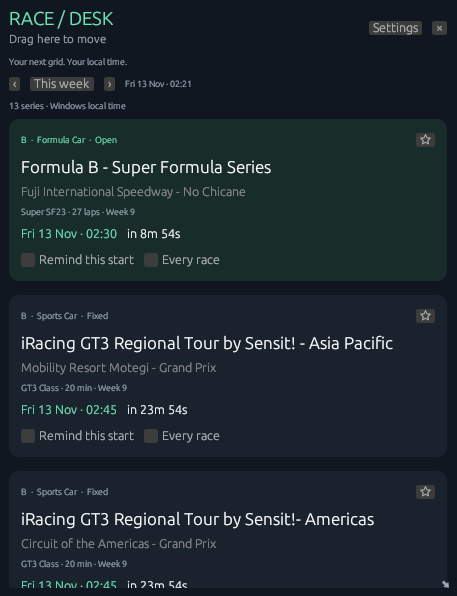

# RaceDesk

A native Rust Windows desktop widget for the public iRacing Week Planner schedule, collected with Scrapling. Windows 10/11 x64. No iRacing login, browser runtime, administrator account or separately installed Python is required.

**[Download the Windows installer](https://github.com/Salutatorian/RaceDesk/releases/latest/download/RaceDesk-Setup-0.1.0-x64.exe)** · [All releases](https://github.com/Salutatorian/RaceDesk/releases)

## Open or install

- Download and double-click [**RaceDesk-Setup-0.1.0-x64.exe**](https://github.com/Salutatorian/RaceDesk/releases/latest/download/RaceDesk-Setup-0.1.0-x64.exe) for a per-user installation and a Start menu shortcut. After installation, you can delete the downloaded installer: the app runs independently from `%LOCALAPPDATA%\Programs\RaceDesk`.
- The installer includes a native Windows uninstaller. No administrator access or separate Python installation is needed.
- For the older portable/source bundle, **Install.cmd** remains available as a development installation method.
- Or double-click **Open RaceDesk.cmd** to run the portable copy. Keep the `app/collector` folder beside `app/RaceDesk.exe`.
- Use **Win+D** to see the widget over your wallpaper. Normal applications cover it.
- Hold and drag anywhere on the large **Drag here to move** bar at the top to move the widget. The title and blank space in that bar both work. Drag the bottom-right arrow to resize it. Position and size are saved.
- Click **Settings**, or right-click the green flag in the Windows notification area and select **Settings and filters**. The icon may be in the tray overflow.

## Filters and ownership

The Filters tab has the source site's five race types, six licence classes, official/unofficial, fixed/open setup, owned cars/tracks and favourite series/cars/tracks. Search narrows series, car and track names. Use the week arrows to browse other weeks.

In **My content**, tick the paid cars and tracks you own. Subscription content is automatically included. Star cars and tracks there; star series on their schedule cards. Ownership is local and is not imported from your iRacing account or your browser's planner settings.

Preferences save automatically as soon as you change them and survive app exit, Windows shutdown and reinstall. If saving fails, the app displays an error. The settings file is `%LOCALAPPDATA%\RaceDesk\RaceDesk\data\settings.json`.

## Reminders

Choose **Remind this start** for the next displayed start, or **Every race** for all future starts of that series while RaceDesk runs. Set the lead time from 1–120 minutes in Settings. Default: 10 minutes. Series reminders continue even if filters hide that series. Clear all reminders in Settings when needed.

Windows must be awake and RaceDesk running. Windows Focus Assist/Do Not Disturb and notification settings can suppress the sound or banner. The app does not wake the PC or send reminders after a race has started. After resume it recalculates upcoming races. Duplicate notification submissions are prevented across restart. Multiple simultaneous reminders are spaced by eight seconds so Windows does not immediately replace them.

Use **Send a test reminder** to check your Windows notification settings. Reminders are based on scheduled starts, not live session status or registration availability; confirm in iRacing before entering a race.

## Startup, exit and removal

In Settings, enable **Open RaceDesk when I sign in to Windows** if wanted. It is off initially. Turn that same switch off to disable startup. Portable startup points to the portable executable, so keep that folder in place.

The widget's **×** or tray **Quit RaceDesk** fully stops the app and reminders. Closing Settings with its title-bar X also quits; use **Widget** to return to the desktop instead.

For an installed copy, use Settings → **Uninstall RaceDesk…**, or Windows Settings → Apps → Installed apps → **RaceDesk** → Uninstall. Removal stops RaceDesk and removes its installation, Start menu shortcut and startup registration. Saved preferences remain for future reinstall. To remove those too, delete the settings folder after removal.

For a portable copy, turn off startup, quit RaceDesk and delete its downloaded folder.

## Data and resource use

Source: [iRacing Week Planner](https://iracing-week-planner.tmo.lol/), by [tmoitie and contributors](https://github.com/tmoitie/iRacing-week-planner). Collector: [Scrapling](https://github.com/d4vinci/Scrapling).

The Rust executable is approximately 5 MB. The bundled Python/Scrapling helper adds disk space but runs only during collection; no browser engine runs in the background. Collection runs on launch, every six hours and when requested. Source changes can break extraction; a failed refresh displays an error and keeps the last valid schedule. A warning appears when cached data is over 48 hours old. New season data depends on the source website being updated.

The widget uses Windows local time. UTC is used internally for scheduling. Planner season exceptions and per-week cars are preserved. Future weather/session cancellations and changes not yet published by the source cannot be predicted.

## Build from source

`cargo build --release` builds the Rust app. `cargo test` checks scheduling, ownership filtering and persistence. `python -m unittest discover -s tests -v` checks collector parsing.

The collector requires Python 3.11+ and `scrapling[fetchers]`. Run `python collector/collect.py schedule.json` to refresh the bundled source snapshot before building Rust. To package the helper, use PyInstaller with Scrapling, curl_cffi, patchright, browserforge and apify_fingerprint_datapoints data included. No downloaded browser binaries are needed. See `Build.ps1` for the reproducible packaging command. Dependency licenses are included in the distribution.
